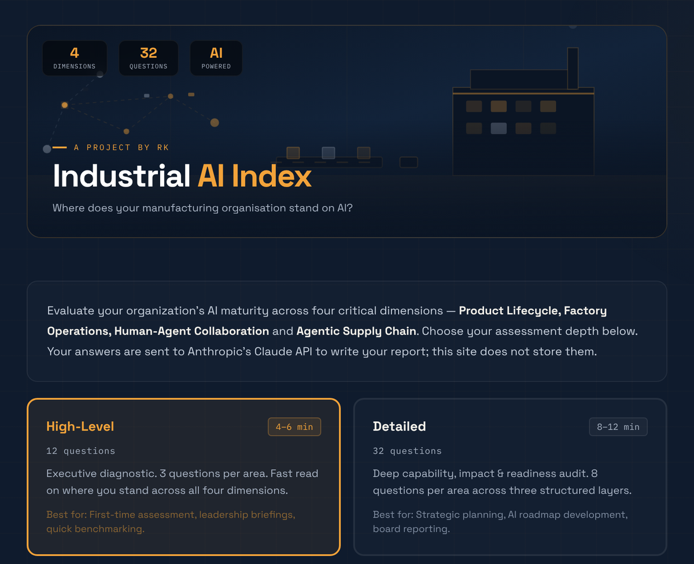
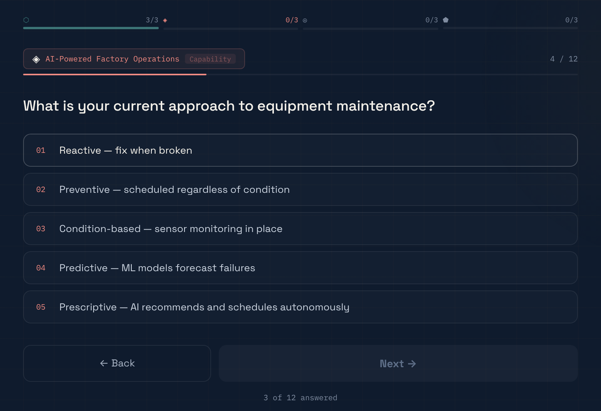
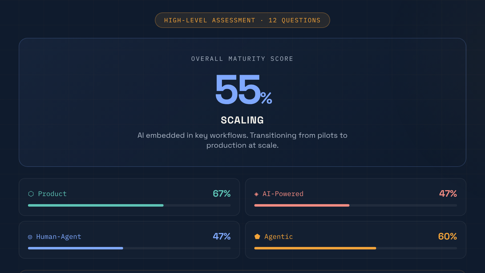
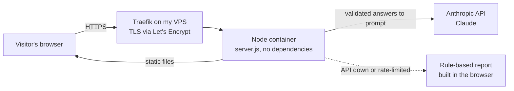

# Industrial AI Index

**Where does your manufacturing organisation stand on AI?** A five-minute self-assessment that gives you a maturity score across four areas and a short strategic report written by Claude.

**Live:** [industrial-ai.radhakrishnakamaraju.com](https://industrial-ai.radhakrishnakamaraju.com) · Part of [radhakrishnakamaraju.com](https://radhakrishnakamaraju.com), alongside [rk-site](https://github.com/radhakrishna-kamaraju/rk-site) and [rk-assistant](https://github.com/radhakrishna-kamaraju/rk-assistant).



## Why I built it

After twenty years in automotive IT, the question I hear most from manufacturing leaders is not "should we use AI?" but "where do we actually start?". Most maturity models answer that with a long consulting engagement. I wanted something a plant manager or CIO could complete in five minutes and leave with a clear picture: where they are strong, where the gaps are, and what to do in the next 90 days.

I first built it as a demo for an industrial trade fair, hosted on Netlify. I then rebuilt it as my own independent project: new name and branding, a hardened server, and hosting on my own VPS.

## What it does

1. **Pick a depth.** High-level (12 questions, 4–6 minutes) for a leadership read-out, or Detailed (32 questions, 8–12 minutes) that scores capability, impact and readiness separately in each area.
2. **Answer the questions** across four areas: Product Lifecycle Intelligence, AI-Powered Factory Operations, Human-Agent Collaboration and Agentic Supply Chain.
3. **Get a score and a report.** An overall maturity level (Foundational → Developing → Scaling → Advanced → Frontier), a score per area, and a report with strengths, critical gaps, three priority actions and a bottom line. You can download it all as a PDF.

| Answering | Results |
|---|---|
|  |  |

## Architecture



- `site/index.html` is the whole page. `site/questions.js` is the question bank, shared by the page and the server so the two can never disagree about which questions exist.
- `server.js` (~270 lines, no npm dependencies) serves the page and exposes one route, `POST /api/report`.
- The same VPS also runs my personal site and its assistant, each in its own container behind Traefik.

## Design decisions

| Decision | Why | Trade-off |
|---|---|---|
| **The browser sends answers, never prompts.** The server validates every answer (integer 1–5, correct question IDs for the mode), strips the free-text industry field down to letters and numbers, and builds the prompt itself. | The API key can only ever produce this one report, so nobody can borrow it as a free chatbot or inject instructions through the form. | Changing the prompt means a redeploy, not a config edit. |
| **Zero-dependency Node server** | Nothing to patch, no supply-chain risk, and the whole backend fits on one screen. | Routing, body-size limits and validation are hand-written instead of coming from a framework. |
| **Rule-based fallback report** | If the API is down, slow (25-second timeout) or rate-limited, the visitor still gets a useful result, and the page says it was written from their scores without AI. | Two report paths to keep consistent. |
| **Hard spend caps:** 3 reports per visitor per hour, 10 per day in total | A public endpoint that calls a paid model, with no caps, is an open tab on my card. | The counters live in memory and reset when the container restarts. Fine at this scale, not at real volume. |
| **Nothing stored:** no email capture, no database, no request bodies in logs | Assessment answers describe a company's weaknesses, and the safest data is data you never keep. | No usage analytics of my own. |
| **Self-hosted fonts and PDF library** | The page makes no third-party requests, so there is no tracking and nothing to break if a CDN goes away. | I update the vendored files myself. |
| **My own VPS instead of Netlify** (Docker + Traefik) | One server for all my projects, and full control over keys, limits and logs. | I am the ops team now: certificates, restarts and updates are on me. |

## What broke, and what's next

**Rate limiting could be bypassed.** The first version read the client IP from the *first* entry in `X-Forwarded-For`. Any client can set that header, so a visitor could send a new fake IP with every request and never hit the limit. The fix uses the *last* entry, which is the one Traefik appends from the real connection. One line of code, but it's the line that decides whether the spend cap actually works.

**Supporting a second kind of API key.** Keys linked to a user identity, rather than scoped to a workspace, need the workspace named on every request. I added an optional `ANTHROPIC_WORKSPACE_ID` setting so either kind of key works.

**Next:**
- Keep the rate-limit counters across restarts.
- Add an automated smoke test that runs on every push and checks the live site and the report route.
- Count reports generated anonymously, with no answers stored, so I can see real usage.

## Limits and privacy

- Rate limits: 3 reports per visitor per hour and 10 per day in total (both configurable in `.env`). Counters are in memory and reset when the container restarts.
- Nothing is stored: no email capture, no database, no request bodies in logs.
- Your answers are sent to Anthropic's API to write the report. Fonts and the PDF library are served from this site, and the page makes no other third-party requests.

## Run

```
cp .env.example .env   # add ANTHROPIC_API_KEY (optionally ANTHROPIC_WORKSPACE_ID, ANTHROPIC_MODEL)
docker compose up -d --build
```

On the VPS, Traefik serves it at https://industrial-ai.radhakrishnakamaraju.com. Without Docker: `ANTHROPIC_API_KEY=... node server.js`, then open http://localhost:3000. Without a key, the page still works and uses the rule-based report.

## Deploy

Push to `main`; a cron job on the VPS pulls every 5 minutes and rebuilds the container if anything changed. `.env` is git-ignored, so deploys never touch the key.

## Credit

The four assessment areas are inspired by Microsoft's e-book
[The Industrial Frontier: Four ways manufacturers can modernize across the value chain](https://info.microsoft.com/ww-landing-the-industrial-frontier.html?lcid=en-us).
The questions, scoring and report prompts are original. This is an independent project, not affiliated with or endorsed by Microsoft.

Built by [Radhakrishna Kamaraju](https://radhakrishnakamaraju.com) · [LinkedIn](https://www.linkedin.com/in/radhakrishna-kamaraju/)
