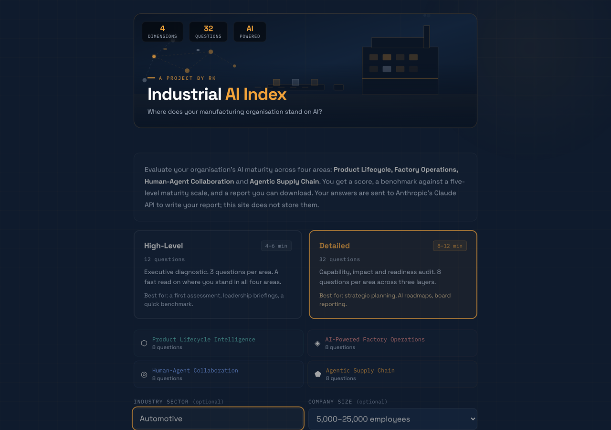
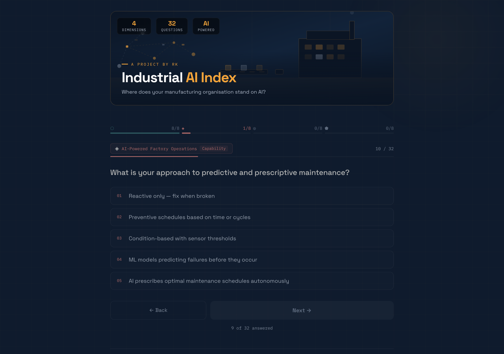
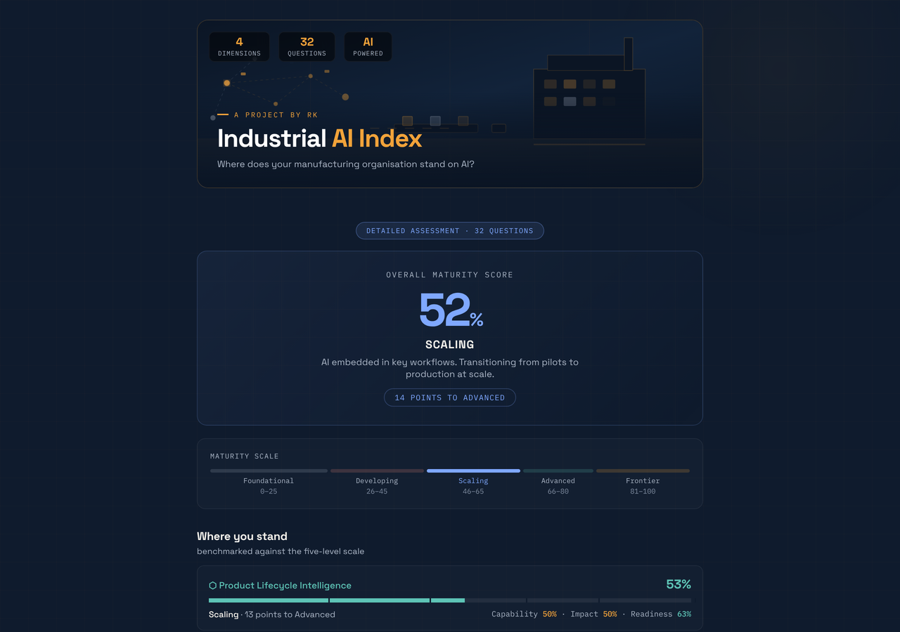
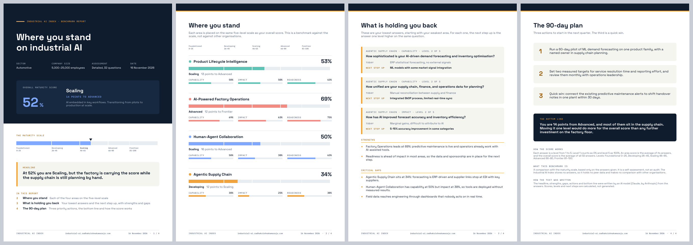
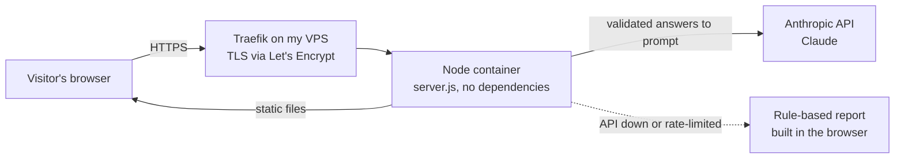

# Industrial AI Index

**Where does your manufacturing organisation stand on AI?** A five-minute self-assessment that gives you a maturity score across four areas, a benchmark against a five-level scale, and a strategic report written by Claude that you can download as a four-page PDF.

**Live:** [industrial-ai.radhakrishnakamaraju.com](https://industrial-ai.radhakrishnakamaraju.com) · Part of [radhakrishnakamaraju.com](https://radhakrishnakamaraju.com), alongside [rk-site](https://github.com/radhakrishna-kamaraju/rk-site) and [rk-assistant](https://github.com/radhakrishna-kamaraju/rk-assistant).



## Why I built it

After twenty years in automotive IT, the question I hear most from manufacturing leaders is not "should we use AI?" but "where do we actually start?". Most maturity models answer that with a long consulting engagement. I wanted something a plant manager or CIO could complete in five minutes and leave with a clear picture: where they are strong, where the gaps are, and what to do in the next 90 days.

I first built it as a demo for an industrial trade fair, hosted on Netlify. I then rebuilt it as my own independent project: new name and branding, a hardened server, and hosting on my own VPS.

## What it does

1. **Pick a depth.** High-level (12 questions, 4–6 minutes) for a leadership read-out, or Detailed (32 questions, 8–12 minutes) that scores capability, impact and readiness separately in each area.
2. **Answer the questions** across four areas: Product Lifecycle Intelligence, AI-Powered Factory Operations, Human-Agent Collaboration and Agentic Supply Chain.
3. **Get a score, a benchmark and a report.** An overall maturity level (Foundational → Developing → Scaling → Advanced → Frontier), each area placed on the same scale with the points needed to reach the next level, your lowest answers with the next step up for each, and a report with strengths, critical gaps, three priority actions and a bottom line.
4. **Download the benchmark report.** A four-page PDF made in the browser: verdict, where you stand, what is holding you back, and the 90-day plan.

| Answering | Results |
|---|---|
|  |  |



## How the score works

Each answer is a level from 1 to 5. Level 1 counts as 0% and level 5 as 100%, so an organisation that picks the lowest answer everywhere scores 0%, not 20%. An area score is the average of its answers; the overall score is the average of all answers. Levels: Foundational 0–25, Developing 26–45, Scaling 46–65, Advanced 66–80, Frontier 81–100.

The benchmark compares you with that scale, not with other organisations. The site stores no answers, so it has no peer data, and the report says so.

## Architecture



- `site/index.html` is the whole page. `site/pdf-report.js` lays out the PDF and is loaded, with the PDF library and fonts, only when a visitor asks for the download. `site/questions.js` is the question bank, shared by the page and the server so the two can never disagree about which questions exist.
- `server.js` (~330 lines, no npm dependencies) serves the page and exposes one route, `POST /api/report`, which returns the report as structured fields (headline, strengths, gaps, actions, bottom line).
- The same VPS also runs my personal site and its assistant, each in its own container behind Traefik.

## Design decisions

| Decision | Why | Trade-off |
|---|---|---|
| **The browser sends answers, never prompts.** The server validates every answer (integer 1–5, correct question IDs for the mode), strips the free-text industry field down to letters and numbers, and builds the prompt itself. | The API key can only ever produce this one report, so nobody can borrow it as a free chatbot or inject instructions through the form. | Changing the prompt means a redeploy, not a config edit. |
| **Zero-dependency Node server** | Nothing to patch, no supply-chain risk, and the whole backend fits on one screen. | Routing, body-size limits and validation are hand-written instead of coming from a framework. |
| **The model fills in a fixed structure** (a forced tool call), and the server checks the shape and length before passing it on | The page and the PDF render fields, not free text, so stray markdown or an odd heading from the model can no longer break the layout. | A reply that doesn't fit the structure is discarded and the visitor gets the rule-based report. |
| **Scores, levels and next steps are calculated, never generated** | The numbers in the report are the same every time for the same answers; the model only writes the commentary. The prompt forbids peer comparisons and statistics, because the model has none. | The benchmark is against the scale only. |
| **Rule-based fallback report** | If the API is down, slow (25-second timeout) or rate-limited, the visitor still gets a useful result, and the page says it was written from their scores without AI. | Two report paths to keep consistent. |
| **Hard spend caps:** 3 reports per visitor per hour, 10 per day in total; failed reports are refunded | A public endpoint that calls a paid model, with no caps, is an open tab on my card. | The counters live in memory and reset when the container restarts. Fine at this scale, not at real volume. |
| **Nothing stored:** no email capture, no database, no request bodies in logs | Assessment answers describe a company's weaknesses, and the safest data is data you never keep. | No usage analytics of my own. |
| **Self-hosted fonts and PDF library** | The page makes no third-party requests, so there is no tracking and nothing to break if a CDN goes away. | I update the vendored files myself. |
| **My own VPS instead of Netlify** (Docker + Traefik) | One server for all my projects, and full control over keys, limits and logs. | I am the ops team now: certificates, restarts and updates are on me. |

## What broke, and what's next

**Rate limiting could be bypassed.** The first version read the client IP from the *first* entry in `X-Forwarded-For`. Any client can set that header, so a visitor could send a new fake IP with every request and never hit the limit. The fix uses the *last* entry, which is the one Traefik appends from the real connection. One line of code, but it's the line that decides whether the spend cap actually works.

**Supporting a second kind of API key.** Keys linked to a user identity, rather than scoped to a workspace, need the workspace named on every request. I added an optional `ANTHROPIC_WORKSPACE_ID` setting so either kind of key works.

**v2 (November 2026): a review of my own app.** I reviewed the live app end to end and fixed what I found:
- *Two quick taps skipped a question.* Each tap scheduled its own "next question", so a double tap advanced twice. The server then rejected the incomplete answers and the page quietly showed the non-AI report. Now only one advance can be pending, and you cannot submit with a question unanswered.
- *The scale started at 20%.* Lowest answers now score 0% (see above). Scores from v1 are not comparable with v2.
- *The PDF was the weakest part.* It printed markdown asterisks, lost symbols, and used pale text on white. It is now the benchmark report, in the site's own fonts.
- *The rule-based report made claims it could not support*, such as how many years behind a competitor you might be. It now says only what your scores show.
- *Failed AI calls used up the limits.* A report that fails on my side is now refunded, for the visitor and for the daily cap.
- *Reviewing your answers and submitting again spent another report.* Unchanged answers now reuse the report you already have, and a refresh no longer loses your progress (it is kept in the browser tab only).
- Also: keyboard access for the depth cards, visible focus, larger text, a share preview image, and no forced splash delay.

**Next:**
- Keep the rate-limit counters across restarts.
- Run the server tests (`node --test test/server.test.js`) automatically on every push, and add a check of the live site.
- Count reports generated anonymously, with no answers stored, so I can see real usage.

## Limits and privacy

- Rate limits: 3 reports per visitor per hour and 10 per day in total (both configurable in `.env`). Counters are in memory and reset when the container restarts.
- Nothing is stored: no email capture, no database, no request bodies in logs. While you are part-way through, your answers are kept in your browser tab (session storage) so a refresh doesn't lose them; they go when you finish or close the tab.
- Your answers are sent to Anthropic's API to write the report. Fonts and the PDF library are served from this site, and the page makes no other third-party requests.

## Run

```
cp .env.example .env   # add ANTHROPIC_API_KEY (optionally ANTHROPIC_WORKSPACE_ID, ANTHROPIC_MODEL)
docker compose up -d --build
```

On the VPS, Traefik serves it at https://industrial-ai.radhakrishnakamaraju.com. Without Docker: `ANTHROPIC_API_KEY=... node server.js`, then open http://localhost:3000. Without a key, the page still works and uses the rule-based report.

Tests: `node --test test/server.test.js` (no dependencies; a local stub stands in for the Anthropic API, so no key is needed).

## Deploy

Push to `main`; a cron job on the VPS pulls every 5 minutes and rebuilds the container if anything changed. `.env` is git-ignored, so deploys never touch the key.

## Credit

The four assessment areas are inspired by Microsoft's e-book
[The Industrial Frontier: Four ways manufacturers can modernize across the value chain](https://info.microsoft.com/ww-landing-the-industrial-frontier.html?lcid=en-us).
The questions, scoring and report prompts are original. This is an independent project, not affiliated with or endorsed by Microsoft.

Built by [Radhakrishna Kamaraju](https://radhakrishnakamaraju.com) · [LinkedIn](https://www.linkedin.com/in/radhakrishna-kamaraju/)
